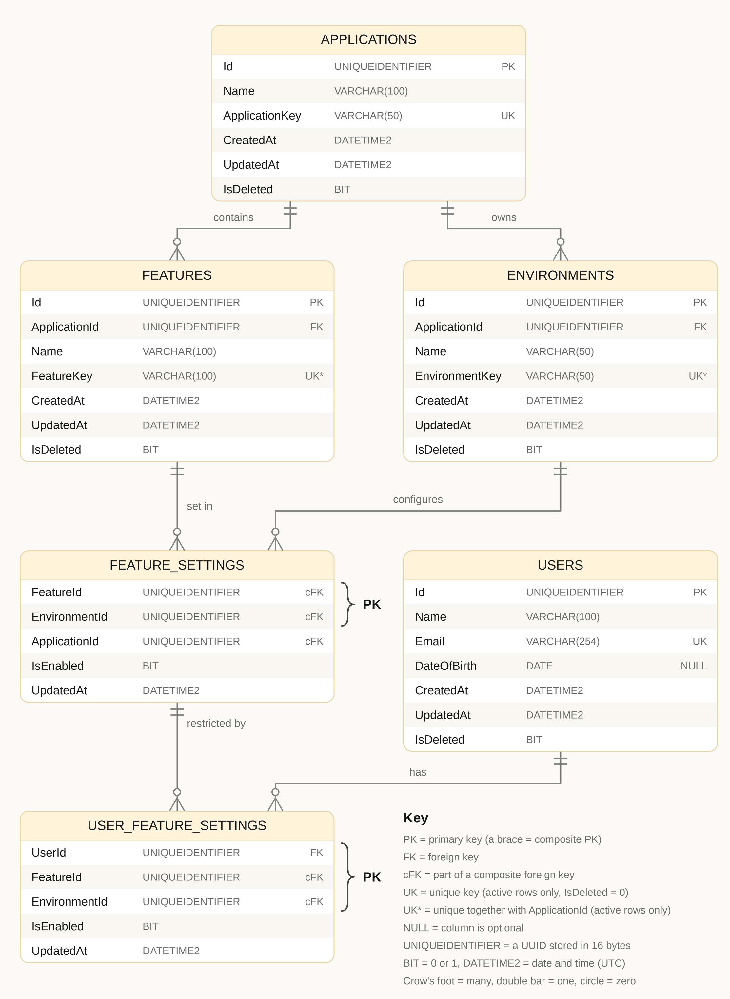

# Feature Flag & Feature Flag Assignment Database

Database design and schema (SQL Server, T-SQL) for managing **feature flags** and controlling them at two levels: **per environment** (Development, Staging, Production) and **per individual user**, with every feature and environment belonging to an **application**.

## Repository structure

```
FeatureFlagDb/
├── README.md                          <- this document (design + explanation)
├── docs/
│   └── erd.png                        <- the entity relationship diagram
├── 000_create_database.sql            <- creates the FeatureFlagDb database
├── 001_applications.sql               <- APPLICATIONS table
├── 002_users.sql                      <- USERS table
├── 003_features.sql                   <- FEATURES table
├── 004_environments.sql               <- ENVIRONMENTS table
├── 005_feature_settings.sql           <- FEATURE_SETTINGS table
├── 006_user_feature_settings.sql      <- USER_FEATURE_SETTINGS table
├── 007_indexes.sql                    <- unique and performance indexes
├── 008_triggers.sql                   <- UpdatedAt triggers
└── tests/
    └── 001_test_app.sql               <- test for the APPLICATIONS table
```

The numbers give the **run order**. A table can only point to a table that already exists, so parents are created before children.

## 1. What is a feature flag?

A feature flag (feature toggle) is a switch stored in the database that lets a team turn a feature on or off **without redeploying code**. The application asks: *"Is feature X on for this user, in this environment?"* and shows or hides the feature accordingly. This allows gradual rollouts, instant shut-off of a buggy feature, and different behaviour in Staging and Production.

## 2. What the database models

The design gives three levels of control:

1. **Does the feature exist?** A feature belongs to one application (`FEATURES`).
2. **Is it on or off in a given environment?** One setting per feature per environment (`FEATURE_SETTINGS`).
3. **Is it on or off for one specific user in that environment?** A per-user override (`USER_FEATURE_SETTINGS`).


## 3. Entity Relationship Diagram (ERD)



### How to read it

| Symbol                    | Meaning                                                      |
| ------------------------- | ------------------------------------------------------------ |
| Double bar                | The "one" side of a relationship (the parent)                |
| Crow's foot               | The "many" side (the child)                                  |
| Circle at the crow's foot | Zero or many: a parent can exist with no children yet        |
| `PK`                      | Primary key. A brace marks a composite PK                    |
| `FK`                      | Foreign key                                                  |
| `cFK`                     | Part of a composite foreign key                              |
| `UK`                      | Unique key, among active rows only (`IsDeleted = 0`)         |
| `UK*`                     | Unique together with `ApplicationId`, among active rows only |
| `NULL`                    | The column is optional                                       |

## 4. Table-by-table explanation

### `APPLICATIONS`
The top of the hierarchy. An application is a software product that uses feature flags.

| Column                   | Type               | Meaning                                                                                   |
| ------------------------ | ------------------ | ----------------------------------------------------------------------------------------- |
| `Id`                     | `UNIQUEIDENTIFIER` | Primary key, generated by `NEWID()`                                                       |
| `Name`                   | `VARCHAR(100)`     | Display name; may change                                                                  |
| `ApplicationKey`         | `VARCHAR(50)`      | Stable, code-level identifier (for example `billing-portal`). Unique, and cannot be empty |
| `CreatedAt`, `UpdatedAt` | `DATETIME2`        | UTC timestamps                                                                            |
| `IsDeleted`              | `BIT`              | Soft-delete flag                                                                          |

### `USERS`
People who can be targeted individually. Users are **global**: they have no `ApplicationId`, so one user can have overrides in any application.

| Column                                | Type               | Meaning                                                                  |
| ------------------------------------- | ------------------ | ------------------------------------------------------------------------ |
| `Id`                                  | `UNIQUEIDENTIFIER` | Primary key                                                              |
| `Name`                                | `VARCHAR(100)`     | Display name; can repeat                                                 |
| `Email`                               | `VARCHAR(254)`     | Unique identifier of a person (254 is the standard maximum email length) |
| `DateOfBirth`                         | `DATE`, nullable   | Optional. Stored as a date so age can be calculated when needed          |
| `CreatedAt`, `UpdatedAt`, `IsDeleted` |                    | As above                                                                 |

### `FEATURES`
The flags themselves (for example "Dark Mode"). Each belongs to exactly one application.

| Column                                | Type               | Meaning                                                                |
| ------------------------------------- | ------------------ | ---------------------------------------------------------------------- |
| `Id`                                  | `UNIQUEIDENTIFIER` | Primary key                                                            |
| `ApplicationId`                       | `UNIQUEIDENTIFIER` | FK to `APPLICATIONS`                                                   |
| `Name`                                | `VARCHAR(100)`     | Display name                                                           |
| `FeatureKey`                          | `VARCHAR(100)`     | Code-level key (for example `dark-mode`). Unique within an application |
| `CreatedAt`, `UpdatedAt`, `IsDeleted` |                    | As above                                                               |

### `ENVIRONMENTS`
Deployment stages (Development, QA, Staging, Production) owned by an application.

| Column                                | Type               | Meaning                                                                 |
| ------------------------------------- | ------------------ | ----------------------------------------------------------------------- |
| `Id`                                  | `UNIQUEIDENTIFIER` | Primary key                                                             |
| `ApplicationId`                       | `UNIQUEIDENTIFIER` | FK to `APPLICATIONS`                                                    |
| `Name`                                | `VARCHAR(50)`      | Display name                                                            |
| `EnvironmentKey`                      | `VARCHAR(50)`      | Code-level key (for example `production`). Unique within an application |
| `CreatedAt`, `UpdatedAt`, `IsDeleted` |                    | As above                                                                |

### `FEATURE_SETTINGS`
The core table. It answers: **"Is feature X enabled in environment Y?"**

| Column          | Type               | Meaning                                  |
| --------------- | ------------------ | ---------------------------------------- |
| `FeatureId`     | `UNIQUEIDENTIFIER` | Part of the composite PK                 |
| `EnvironmentId` | `UNIQUEIDENTIFIER` | Part of the composite PK                 |
| `ApplicationId` | `UNIQUEIDENTIFIER` | Consistency guard (see section 5)        |
| `IsEnabled`     | `BIT`              | The on/off switch. Defaults to `0` (off) |
| `UpdatedAt`     | `DATETIME2`        | When the setting last changed            |

Features and environments have a many-to-many relationship. This is the **junction table** that resolves it, and `IsEnabled` describes the pairing: a feature is not simply on or off, it is on or off *in a given environment*.

### `USER_FEATURE_SETTINGS`
Per-user overrides: *"For this user, feature X in environment Y is on or off."*

| Column          | Type               | Meaning                                          |
| --------------- | ------------------ | ------------------------------------------------ |
| `UserId`        | `UNIQUEIDENTIFIER` | FK to `USERS`; part of the composite PK          |
| `FeatureId`     | `UNIQUEIDENTIFIER` | Part of the composite PK and of the composite FK |
| `EnvironmentId` | `UNIQUEIDENTIFIER` | Part of the composite PK and of the composite FK |
| `IsEnabled`     | `BIT`              | Defaults to `0` (off)                            |
| `UpdatedAt`     | `DATETIME2`        | When the override last changed                   |

## 5. Relationships

| Parent (one)       | Child (many)            | Label         | Meaning                                                                   |
| ------------------ | ----------------------- | ------------- | ------------------------------------------------------------------------- |
| `APPLICATIONS`     | `FEATURES`              | contains      | An application has many features; each feature belongs to one application |
| `APPLICATIONS`     | `ENVIRONMENTS`          | owns          | An application has many environments; each belongs to one application     |
| `FEATURES`         | `FEATURE_SETTINGS`      | set in        | A feature has a setting per environment                                   |
| `ENVIRONMENTS`     | `FEATURE_SETTINGS`      | configures    | An environment has a setting per feature                                  |
| `FEATURE_SETTINGS` | `USER_FEATURE_SETTINGS` | restricted by | A user override can only exist where a feature setting exists             |
| `USERS`            | `USER_FEATURE_SETTINGS` | has           | A user can have many overrides                                            |

## 6. Key design decisions

1. **`UNIQUEIDENTIFIER` for every ID.** It takes 16 bytes instead of the 36 of a text UUID, rejects invalid values, and compares faster. Every ID column uses the same type so foreign keys match.

2. **Composite primary keys on the settings tables.** `FEATURE_SETTINGS` is identified by (`FeatureId`, `EnvironmentId`), so there can be only one setting per feature per environment. `USER_FEATURE_SETTINGS` is identified by (`UserId`, `FeatureId`, `EnvironmentId`).

3. **Composite foreign keys keep data consistent.** `FEATURE_SETTINGS` carries an `ApplicationId` so the database can guarantee that a feature and an environment belong to the **same application**:
   - (`FeatureId`, `ApplicationId`) points to `FEATURES (Id, ApplicationId)`
   - (`EnvironmentId`, `ApplicationId`) points to `ENVIRONMENTS (Id, ApplicationId)`

   SQL Server only lets a foreign key point at columns declared unique, so `FEATURES` and `ENVIRONMENTS` each have an extra `UNIQUE (Id, ApplicationId)` constraint. It adds no business rule, because `Id` is already unique. It exists only to support these foreign keys.

   `USER_FEATURE_SETTINGS` points to `FEATURE_SETTINGS` through the pair (`FeatureId`, `EnvironmentId`). A user override therefore cannot exist for a feature that has no setting in that environment.

4. **Keys are unique per application.** Two applications may both have a `dark-mode` feature or a `production` environment, but one application cannot have either twice. This is the `UK*` rule, enforced by unique indexes on (`ApplicationId`, key).

5. **Soft delete.** `APPLICATIONS`, `USERS`, `FEATURES` and `ENVIRONMENTS` have an `IsDeleted` flag. A deleted row stays in the table and is marked `IsDeleted = 1`. The unique indexes are **filtered** with `WHERE IsDeleted = 0`, so a deleted row no longer blocks its key or email from being reused. The two settings tables have no soft delete and are removed with a normal `DELETE`.

6. **No cascading deletes.** Foreign keys use SQL Server's default `NO ACTION`, so a parent that still has children cannot be removed by accident.

7. **`UpdatedAt` is maintained by triggers.** A `DEFAULT` only fills a value when a row is inserted, so one `AFTER UPDATE` trigger per table refreshes `UpdatedAt` whenever a row changes, whoever or whatever made the change.

8. **UTC timestamps.** `CreatedAt` and `UpdatedAt` default to `SYSUTCDATETIME()` and are stored as `DATETIME2`, so times are not affected by server or user time zones.

9. **Safe defaults.** `IsEnabled` defaults to `0` and `IsDeleted` defaults to `0`. A new flag never switches itself on.

10. **Named constraints.** Every primary key, foreign key, default, check and unique constraint has an explicit name (`PK_`, `FK_`, `DF_`, `CK_`, `UQ_`), so error messages and later changes are easy to read.

## 7. Rules for reading the data

These are conventions for anyone querying the tables.

- **User override first.** If a row exists in `USER_FEATURE_SETTINGS` for the user, feature and environment, it wins.
- **Then the environment setting.** Otherwise use `IsEnabled` from `FEATURE_SETTINGS`.
- **No setting means off.** If neither row exists, treat the feature as off.
- **Skip deleted rows.** Filter on `IsDeleted = 0` for the application, feature, environment and user.

## 8. What each script does

| File                            | What it does                                                                                                        |
| ------------------------------- | ------------------------------------------------------------------------------------------------------------------- |
| `000_create_database.sql`       | Creates the `FeatureFlagDb` database if it does not exist, then switches to it                                      |
| `001_applications.sql`          | Creates `Applications` with defaults, primary key and a check that `ApplicationKey` is not empty                    |
| `002_users.sql`                 | Creates `Users`                                                                                                     |
| `003_features.sql`              | Creates `Features`, with the foreign key to `Applications` and the `UNIQUE (Id, ApplicationId)` constraint          |
| `004_environments.sql`          | Creates `Environments`, with the same two constraints                                                               |
| `005_feature_settings.sql`      | Creates `FeatureSettings`, with the composite primary key and the two composite foreign keys                        |
| `006_user_feature_settings.sql` | Creates `UserFeatureSettings`, with the composite primary key and the foreign keys to `Users` and `FeatureSettings` |
| `007_indexes.sql`               | Creates four filtered unique indexes and two performance indexes (see below)                                        |
| `008_triggers.sql`              | Creates six `AFTER UPDATE` triggers that refresh `UpdatedAt`                                                        |

### Indexes in `007_indexes.sql`

| Index                        | Table and columns                                                    | Purpose                                                                                                         |
| ---------------------------- | -------------------------------------------------------------------- | --------------------------------------------------------------------------------------------------------------- |
| `UX_App_Key`                 | `Applications (ApplicationKey)` where `IsDeleted = 0`                | No duplicate application keys                                                                                   |
| `UX_User_Email`              | `Users (Email)` where `IsDeleted = 0`                                | No duplicate emails                                                                                             |
| `UX_Feature_App_Key`         | `Features (ApplicationId, FeatureKey)` where `IsDeleted = 0`         | Feature key unique per application                                                                              |
| `UX_Env_App_Key`             | `Environments (ApplicationId, EnvironmentKey)` where `IsDeleted = 0` | Environment key unique per application                                                                          |
| `IX_FeatureSetting_Env`      | `FeatureSettings (EnvironmentId)`                                    | Fast lookups of all settings in one environment; the primary key only helps lookups that start with `FeatureId` |
| `IX_UserSetting_Feature_Env` | `UserFeatureSettings (FeatureId, EnvironmentId)`                     | Supports the foreign key to `FeatureSettings`; SQL Server does not index foreign keys automatically             |

### Triggers in `008_triggers.sql`

`TR_Applications_UpdatedAt`, `TR_Users_UpdatedAt`, `TR_Features_UpdatedAt`, `TR_Environments_UpdatedAt`, `TR_FeatureSettings_UpdatedAt` and `TR_UserFeatureSettings_UpdatedAt`. Each uses the `inserted` table to find the rows that were just changed and joins on the full primary key.

## 9. How to run it

Requires **SQL Server 2016 SP1 or later** (the scripts use `CREATE OR ALTER`). They were written on SQL Server 2025 Developer Edition and can be run from VS Code with the SQL Server (mssql) extension, from SSMS, or with `sqlcmd`.

1. Connect to your server (for a local install, `localhost`) in a window that starts on `master`.
2. Run `000_create_database.sql`.
3. Run the remaining files **in numeric order**, from `001` to `008`.

Each file after `000` must run against `FeatureFlagDb`. Most start with `USE FeatureFlagDb;`. For `001_applications.sql`, open the query window by right-clicking `FeatureFlagDb` in the left panel and choosing **New Query**, so it starts on the right database.

Notes:

- The table scripts check `IF OBJECT_ID(...) IS NULL`, so running them twice is harmless.
- `007_indexes.sql` and `008_triggers.sql` are different. Running `007` twice gives an "already exists" error, which is harmless. `008` uses `CREATE OR ALTER`, so it can be re-run.
- To start over, drop the `FeatureFlagDb` database and run `000` to `008` again.

## 10. Testing

`tests/001_test_app.sql` inserts a test application with only a name and key, selects it to show that the `Id`, `CreatedAt`, `UpdatedAt` and `IsDeleted` columns fill in by themselves, and then deletes the test row using a `WHERE` on its key.

Run it after `001`, in a window connected to `FeatureFlagDb`. If the selected row shows a generated `Id`, two timestamps and `IsDeleted = 0`, the defaults work.

## 11. Conventions

- Table names are in `PascalCase` in SQL (`FeatureSettings`) and shown as `UPPER_SNAKE_CASE` in the ERD (`FEATURE_SETTINGS`).
- Column names use `PascalCase`.
- Every `DELETE` and `UPDATE` should include a `WHERE`.
- Every manual `UPDATE` on a soft-deletable table that sets `IsDeleted = 1` is picked up by the `UpdatedAt` trigger, so it does not need to set `UpdatedAt` itself.


